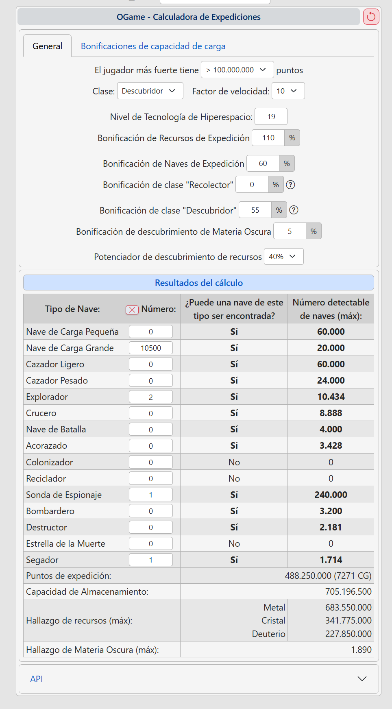

# Analizador de universos OGame

Herramienta en Python para consultar la API pública de OGame en cualquier universo.
Pensada para universos grandes y circulares (donut), como Xolotlan (279).

## Requisitos

- Python 3.10 o superior
- `pip install -r requirements.txt` (solo depende de `requests`)

## Configurar el universo

Edita `universo.json`:

```json
{
  "idioma": "es",
  "numero": 268,
  "pausa_segundos": 0.1
}
```

También puedes indicarlo al ejecutar, sin tocar el fichero: `--universo idioma:numero`.

> Xolotlan (279) existe en los idiomas `de`, `en`, `fr` e `it` (no en `es`). Para usarlo, pon su idioma, por ejemplo `"idioma": "de", "numero": 279`.

## Uso

Menú interactivo:

```powershell
python -m analizador
```

Desde la línea de comandos:

```powershell
python -m analizador listar
python -m analizador --universo es:268 ejecutar servidor
python -m analizador ejecutar ranking --param categoria=1 --param tipo=3 --param limite=50 --formato csv
python -m analizador ejecutar distancia --param jugador=100604
```

Los ficheros exportados se guardan en `output/<idioma>-<numero>/` con la fecha en el nombre (por ejemplo `ranking_30-10-2026.csv`); en Markdown el título también lleva la fecha (`30/10/2026`). `pausa_segundos` es el intervalo mínimo entre peticiones (0,25 s por defecto); si la API responde 503/429 el programa se ralentiza solo (la API aguanta ~1 petición/s de forma sostenida). Los datos de jugadores se guardan en un único fichero por universo (`output/.cache/<universo>/detalles_jugadores.json`) durante 6 horas, así que repetir consultas es casi instantáneo (borra ese fichero para forzar la descarga).

## Consultas disponibles

| Id                           | Qué hace                                                                                                                                                                                                                                                                                                                                                                                                                                                                 |
| ---------------------------- | ------------------------------------------------------------------------------------------------------------------------------------------------------------------------------------------------------------------------------------------------------------------------------------------------------------------------------------------------------------------------------------------------------------------------------------------------------------------------ |
| `servidor`                   | Galaxias, sistemas y si el universo es circular                                                                                                                                                                                                                                                                                                                                                                                                                          |
| `universos_lobby`            | Lista de universos del lobby (filtro por idioma)                                                                                                                                                                                                                                                                                                                                                                                                                         |
| `jugadores`                  | Todos los jugadores con estado y alianza                                                                                                                                                                                                                                                                                                                                                                                                                                 |
| `jugadores_inactivos`        | Jugadores inactivos ahora (param. `incluir_vacaciones`)                                                                                                                                                                                                                                                                                                                                                                                                                  |
| `jugadores_nuevos_inactivos` | Nuevos inactivos desde la última ejecución de esta consulta, sin los que están en vacaciones. Guarda la captura en `output/.estado/<universo>/` con una cabecera (universo, fecha) que se valida al leerla: si no coincide con el universo activo se descarta y se empieza de nuevo; la primera vez solo la crea. Cada jugador incluye a la derecha todos sus planetas (`planetas`, `num_planetas`) y la lista se guarda también en `nuevos_inactivos_ultima_lista.json` |
| `alianzas`                   | Listado completo de alianzas                                                                                                                                                                                                                                                                                                                                                                                                                                             |
| `ranking`                    | Highscore por categoría (jugadores/alianzas) y tipo                                                                                                                                                                                                                                                                                                                                                                                                                      |
| `alianza_miembros`           | Miembros de una alianza con puntos y naves                                                                                                                                                                                                                                                                                                                                                                                                                               |
| `jugador_detalle`            | Planetas y lunas de un jugador                                                                                                                                                                                                                                                                                                                                                                                                                                           |
| `top_lunas`                  | Jugadores del top con lunas y sus coordenadas                                                                                                                                                                                                                                                                                                                                                                                                                            |
| `alianza_top_lunas`          | Coordenadas de lunas de una alianza                                                                                                                                                                                                                                                                                                                                                                                                                                      |
| `distribucion_galaxias`      | Planetas de los N mejores del ranking militar por galaxia                                                                                                                                                                                                                                                                                                                                                                                                                |
| `seguimiento_vivo`           | **Ventana en vivo** con los puntos militares destruidos (verde) y perdidos (rojo) en cada actualización del highscore                                                                                                                                                                                                                                                                                                                                                    |
| `distancia`                  | Distancia entre los planetas de un jugador por galaxia (donut)                                                                                                                                                                                                                                                                                                                                                                                                           |
| `informe_espionaje`          | **Formulario web local**: pegas un informe de espionaje, se ordena en tablas, se guarda y se exporta a json/csv/md                                                                                                                                                                                                                                                                                                                                                       |
| `ultima_flota`               | Última flota conocida de un jugador (cabecera, naves y resto de secciones) según los informes guardados                                                                                                                                                                                                                                                                                                                                                                  |

## Seguimiento en vivo

La opción `seguimiento_vivo` abre una ventana con la hora y la fecha de cada actualización y, debajo, los jugadores de la alianza **MD/ML** que han **destruido** puntos militares (verde, `+`, highscore tipo 6) y los que los han **perdido** (rojo, `-`, tipo 4). El filtro se aplica antes de seleccionar los mayores cambios, y se queda abierta y se actualiza sola hasta que la cierres; al cerrarla ofrece exportar los cambios recibidos.

- La API de OGame regenera el highscore **cada hora**. El programa calcula cuándo toca la siguiente actualización, hace una comprobación de seguridad cada 5 minutos mientras espera y, al pasar la hora esperada, sondea cada 15 s hasta que cambia el `timestamp` y lo descarga al instante.
- La API regenera cada tipo de highscore en un segundo distinto (el de perdidos, tipo 4, unos 35 s después del de destruidos, tipo 6). Una captura solo se considera nueva cuando **ambos** se han actualizado; si no, los rojos salían vacíos o con datos de la hora anterior. La hora mostrada es la del último ranking regenerado.
- La última captura se guarda en `output/.estado/<universo>/puntos_ultima_captura.json` (con cabecera de universo). Al reabrir la ventana, si ha habido actualizaciones desde entonces, se muestran de inmediato; la primera vez hay que esperar a la siguiente actualización de la API.
- Parámetro `top`: jugadores a mostrar en cada lado por actualización (10 por defecto).
- Necesita `tkinter`, que viene con el instalador oficial de Python para Windows.

## Qué es cada dato (columnas de las tablas)

Referencia para futuras modificaciones. Mantenla actualizada al cambiar una tabla.

**Tipos de highscore** (`category=1` jugadores, `2` alianzas): 0 total, 1 economía, 2 investigación, **3 militar** (con `ships` = número de naves; es el «top de flota»), **4 militar perdido**, **5 militar construido**, **6 militar destruido**, 7 honor. Se cumple militar (3) = construido (5) − perdido (4). Coincide con lo que muestra mmorpg-stat.eu.

**Estados de jugador** (`status` de `players.xml`): vacío activo, `i` inactivo 7 días, `I` inactivo 28+ días, `v` vacaciones, `b` bloqueado, `a` admin.

| Consulta                           | Columnas                                                                                                                                                                          | Significado                                                                                                                                                                                                                                                   |
| ---------------------------------- | --------------------------------------------------------------------------------------------------------------------------------------------------------------------------------- | ------------------------------------------------------------------------------------------------------------------------------------------------------------------------------------------------------------------------------------------------------------- |
| `jugadores`, `jugadores_inactivos` | `id`, `nombre`, `estado`, `alianza`                                                                                                                                               | `estado` es el texto del `status`; `alianza` es la etiqueta (tag) o vacío                                                                                                                                                                                     |
| `jugadores_nuevos_inactivos`       | las anteriores + `planetas`, `num_planetas`                                                                                                                                       | `planetas` son todas las coordenadas `G:S:P` del jugador separadas por coma (listas para atacar); `num_planetas` su recuento. Excluye jugadores en vacaciones                                                                                                 |
| `alianzas`                         | `id`, `name`, `tag`                                                                                                                                                               | Alianza, nombre y etiqueta                                                                                                                                                                                                                                    |
| `alianza_miembros`                 | `id`, `nombre`, `estado`, `puntos_militares`, `naves`                                                                                                                             | `puntos_militares` es el score del tipo 3; `naves` las naves de ese ranking                                                                                                                                                                                   |
| `jugador_detalle`                  | `id`, `nombre`, `planetas[{coords, lunas}]`                                                                                                                                       | `lunas` = lunas de ese planeta                                                                                                                                                                                                                                |
| `top_lunas`, `alianza_top_lunas`   | `id`, `nombre`, `lunas`, `coordenadas`                                                                                                                                            | `lunas` = total de lunas del jugador; `coordenadas` = las de sus lunas                                                                                                                                                                                        |
| `ranking`                          | `posicion`, `id`, `nombre`, `puntuacion`, `naves`                                                                                                                                 | `puntuacion` según el tipo elegido; `naves` solo tiene sentido en el tipo 3                                                                                                                                                                                   |
| `distribucion_galaxias`            | `galaxia`, `planetas`                                                                                                                                                             | Planetas de los N mejores del ranking militar (tipo 3) en cada galaxia; el resumen suma las naves del top                                                                                                                                                     |
| `distancia`                        | `galaxia`, `planeta_a`, `planeta_b`, `sistemas`, `unidades`                                                                                                                       | Un par de planetas del mismo jugador y galaxia. `sistemas` = diferencia de sistemas (menor vuelta si hay donut); `unidades` = distancia de vuelo (2700 + 95 × sistemas; mismo sistema: 1000 + 5 × diferencia de planeta). Fórmula sin contrastar con el juego |
| `servidor`                         | `idioma`, `numero`, `nombre`, `galaxias`, `sistemas`, `donut_galaxia`, `donut_sistema`, `velocidad_economia`, `velocidad_flota_guerra`, `factor_escombros`, `tamano_campos_bonus` | Configuración del universo (`serverData.xml`)                                                                                                                                                                                                                 |
| `universos_lobby`                  | `idioma`, `numero`, `nombre`, `jugadores`, `online`, `abierto`, `cerrado`                                                                                                         | Datos del lobby de Gameforge                                                                                                                                                                                                                                  |
| `seguimiento_vivo` (exportación)   | `fecha`, `jugador`, `alianza`, `tipo`, `puntos`                                                                                                                                   | `tipo` = `destruidos` (puntos > 0, tipo 6) o `perdidos` (puntos < 0, tipo 4); `puntos` = variación entre dos actualizaciones del highscore                                                                                                                    |

**Archivos de estado** (`output/.estado/<universo>/`, ignorados por git): `inactivos_ultima_captura.json` (cabecera `universo`, `fecha`, lista `inactivos`), `nuevos_inactivos_ultima_lista.json` (última lista de nuevos inactivos con planetas) y `puntos_ultima_captura.json` (cabecera `universo`, `version`, `timestamp`; si cambia el significado de los datos, sube `VERSION_CAPTURA` en `seguimiento.py` para descartar las antiguas). Caché de detalles: `output/.cache/<universo>/detalles_jugadores.json`.

## Informes de espionaje

La opción `informe_espionaje` abre en el navegador un formulario local (`127.0.0.1`, puerto libre al azar; Ctrl+C en la consola para cerrarlo). Pega un informe de espionaje, pulsa **Analizar** y verás la cabecera y una tabla por sección. Los botones **Exportar JSON / CSV / MD** descargan el archivo y guardan una copia en `output/<universo>/flotas/espionaje_<jugador>_dd-mm-aaaa.<fmt>`.

Todo lo relativo a flotas vive en una sola carpeta por universo, `output/<universo>/flotas/` (p. ej. `output/es-268/flotas/`): `informes.json`, las exportaciones del formulario y las de `ultima_flota`. La carpeta se crea sola si no existe; los informes que estuvieran en la antigua `output/espionaje/informes.json` se mueven allí automáticamente al primer uso.

- El lector (`analizador/espionaje.py`) acepta el texto tal como se copia de la página del juego (con la línea de título, imágenes, `Jugador:  Nombre(ph)` en una línea y la sección pegada al primer dato, p. ej. `FlotasNave pequeña de carga`) y también el formato anterior con cada dato en su línea.
- De la línea de título `Informe de espionaje en Luna Nombre [G:S:P] dd.mm.aaaa hh:mm:ss` se guardan en la cabecera `Coordenadas`, `Ubicación` (tipo y nombre: Planeta o Luna) y `Fecha del informe`. Son el dato clave para saber dónde está la flota; salen justo detrás de `Jugador` y `Estado`.
- El lector es genérico: la cabecera admite cualquier `Clave:` (valor en la misma línea o en la siguiente) y cualquier sección nueva (p. ej. «Campo de escombros») se detecta sola, así que los informes pueden traer datos distintos. Las secciones ausentes (p. ej. sin «Defensa») simplemente no aparecen.
- La línea entre paréntesis tras el jugador, como `(v ph)`, se guarda tal cual en `Estado`, sin interpretarla.
- Los valores abreviados de la cabecera (`823,854M`, `7Mrd`) se guardan como texto; las cantidades de las secciones son números enteros.
- Cada informe que analizas se guarda automáticamente en `output/<universo>/flotas/informes.json` (lista de `{jugador, guardado, informe}`, con fecha y hora). Si pegas uno idéntico al último guardado de ese jugador no se duplica. El archivo está ignorado por git.
- `ultima_flota` (opción 16) pide el nombre del jugador (vale una parte, sin distinguir mayúsculas) y devuelve su informe más reciente (por la fecha del informe; si no la trae, por la de guardado): fecha de guardado, la cabecera tal como se muestra al analizar (`Jugador`, `Estado`, `Coordenadas`, `Ubicación`, `Fecha del informe`, `Clase`, `Recursos`, `Botín`, `Flotas`...), la lista de naves y después el resto de secciones del informe (recursos, campo de escombros, defensa, edificios, investigación y forma de vida). Al exportarla, el archivo se llama `ultima_flota_<jugador>_dd-mm-aaaa.<fmt>` (en `output/<universo>/flotas/`). Si el nombre coincide con varios jugadores, los lista; si no hay informes, lo indica.
- Formato de exportación: JSON conserva la estructura `{cabecera, mensajes, secciones}`; CSV y MD usan una fila por dato con las columnas `seccion`, `concepto`, `valor`.

## Mensajes del juego

`mensajes_formulario` abre en el navegador un formulario local (igual que el de espionaje). Pega la conversación completa tal cual la copias del juego: se ignora lo anterior a `Imperio`, y cada línea con un nombre pegado a una fecha `dd.mm.aaaa hh:mm:ss` inicia un mensaje, cuyo texto llega hasta el siguiente nombre+fecha. También acepta mensajes individuales con su enlace de planeta. Pulsa **Guardar**. Se guardan en `output/<universo>/mensajes/mensajes.json`:

- Fecha de recepción, remitente, destinatario cuando se puede determinar por los participantes de la conversación, alianza cuando el formato la incluye y texto del mensaje (sin enlaces).
- Coordenadas del jugador indicado tras `Imperio` (o del enlace del mensaje individual) y, a partir de ellas, el **id del jugador**: primero se busca entre los jugadores con ese nombre; si ninguno tiene ese planeta (p. ej. cambió de nombre), se recorren todos los jugadores. Esa búsqueda completa hace una petición por jugador la primera vez (la caché de jugadores dura 6 h). Para los demás participantes de una conversación, se usa un nombre exacto y único; si no se puede resolver, el mensaje queda sin id.
- Un mensaje repetido (misma fecha, remitente y texto) no se duplica.
- `mensajes_jugador` muestra también el destinatario. Al volver a pegar una conversación ya guardada, se completan los destinatarios que faltaban en los registros antiguos, sin duplicar los mensajes.

`mensajes_jugador` (pide nombre o parte del nombre, o id) devuelve sus mensajes ordenados por fecha. Como se vinculan por id, siguen apareciendo tras un cambio de nombre. Los mensajes sin id se buscan por el nombre con el que se recibieron.

## Añadir una consulta nueva

1. Crea una función en `analizador/consultas/` (o añádela a un módulo existente).
2. Decórala con `@consulta(id, descripcion, parametros)`. Recibe `contexto` y los parámetros, y devuelve un `Resultado`.
3. Importa el módulo en `analizador/consultas/__init__.py` si es un fichero nuevo.

```python
from .registro import Parametro, Resultado, consulta

@consulta("mi_consulta", "Descripción corta",
          (Parametro("limite", "Número de filas", int, 20),))
def mi_consulta(contexto, limite=20):
    datos = contexto.highscore(1, 3)[:limite]
    return Resultado(datos=datos, titulo="Mi consulta", resumen=[f"Filas: {len(datos)}"])
```

Usa `contexto` para obtener datos ya cacheados: `jugadores()`, `alianzas()`, `highscore(categoria, tipo)`, `detalle_jugador(id)`, `detalles(ids)`, `servidor()`, `resolver_jugador(texto)`, `resolver_alianza(texto)`.

Los endpoints y su formato están documentados en [docs/api.md](docs/api.md).

## Tests

```powershell
python -m unittest
```

Los tests no usan la red.

## Iniciar el programa

& "C:\Users\siemp\AppData\Local\Programs\Python\Python312\python.exe" -m analizador

& "C:\Users\siemp\AppData\Local\Programs\Python\Python312\python.exe" -m analizador

## NOTA SOBRE EXPEDICIONES


